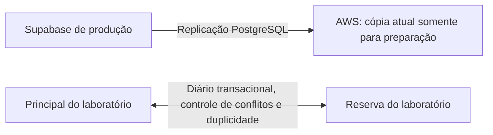

# Reserva AWS: espelhamento e laboratório de queda/retorno

O laboratório permite vender em duas cópias isoladas, simular a indisponibilidade do principal, assumir na reserva e transmitir as alterações na volta. O Supabase de produção continua como principal dos clientes. **O laboratório não é um botão de contingência de produção.**

Há dois fluxos separados:

As duas bases do laboratório estão na mesma instância RDS. O ensaio verifica a aplicação e o protocolo de troca; não representa dois servidores com falhas independentes. Os dados iniciais do laboratório são da cópia de 07/11/2026. Dados criados nele não são enviados ao Supabase real.

## Acesso para Angelo

- [Simulador de queda e retorno](https://florest-reserva.77-112-23-104.sslip.io/simulador/).
- [ERP de teste](https://florest-reserva.77-112-23-104.sslip.io/erp/).
- [Conferir uma venda nos dois bancos](https://florest-reserva.77-112-23-104.sslip.io/conferir/).

O endereço é temporário, associado ao IPv4 atual da EC2. Não alterar o apontamento do ERP de produção para esse endereço.

1. Abra [AWS Systems Manager → Parameter Store](https://us-east-2.console.aws.amazon.com/systems-manager/parameters/?region=us-east-2&tab=Table).
2. Pesquise `/florest/reserva/test-control-code`, abra o parâmetro e escolha mostrar o valor descriptografado.
3. Cole o código no simulador. Ele autoriza somente os botões do laboratório; não precisa ser enviado ao chat.
4. Use **Principal voltou: transmitir e retornar** para iniciar pelo principal de teste.
5. No ERP de teste, atualize a página antes de começar, entre com seus dados existentes na cópia e faça uma venda.
6. No simulador, use **Simular queda do principal** e depois **Assumir na AWS reserva**.
7. Faça outra venda. Consulte o número na AWS; o principal indisponível ainda não deve recebê-la.
8. Use **Principal voltou: transmitir e retornar**. Consulte as duas vendas nos dois bancos e confirme que cada uma aparece uma vez.

A emissão fiscal, as chamadas externas e funções ainda não implantadas permanecem bloqueadas. Não usar o laboratório para atendimento de clientes reais.

## Comportamento implementado

- Auth próprio, PostgREST e função original de login; assinatura das sessões independente do Supabase hospedado.
- RLS e permissões por coluna mantidas. Usuários não recebem acesso ao diário de alterações.
- Apenas um banco do laboratório aceita gravações comerciais. A barreira no PostgreSQL espera as transações em andamento antes da troca.
- Operações de venda recebem um identificador persistido no navegador e confirmado no banco. Repetir a mesma tentativa, inclusive após a troca, retorna o mesmo resultado.
- A preparação original de taxas e bandeiras é preservada; a tentativa pendente guarda os mesmos argumentos para eventual repetição.
- Quando o principal do laboratório está disponível, a confirmação da venda aguarda seu registro no espelho. Durante a queda simulada, a reserva grava a venda e mantém o retorno pendente no diário.
- O retorno aplica uma transação inteira de cada vez. Valores NUMERIC, JSON, arrays, timestamps e bytea permanecem tipados pelo PostgreSQL.
- O destino verifica o estado anterior da linha antes de alterá-la. Divergências interrompem a transferência sem sobrescrever dados.
- Confirmações por evento tornam a retransmissão idempotente, inclusive quando a confirmação ao emissor se perde.
- Antes de habilitar o novo escritor, as sequências são ajustadas com `RESTART`, invalidando valores antigos em cache.
- O controlador, o código do teste e os scripts de retorno restringem os destinos aos bancos isolados. Não há credencial de escrita do Supabase no controlador.

## Espelhamento real preparado

A publicação dedicada no Supabase alimenta `florest_reserva_sync_20261108` na AWS. A conferência validou 153 tabelas prontas, estrutura equivalente e vendas/itens iguais à origem. O monitor consulta estado, atraso, erros e alterações de estrutura a cada minuto.

A assinatura nativa usa uma ponte PostgreSQL privada na EC2. O trecho até o Supabase valida o certificado da origem. O trecho RDS–ponte usa TLS dentro da VPC, restrito pelo grupo de segurança do RDS; o runtime gerenciado não aceitou a CA pública do certificado da ponte com `sslrootcert=system`. Essa configuração não expõe a porta PostgreSQL do RDS à internet.

A origem já limita a retenção de WAL por slot a 512 MB. Se uma interrupção invalidar o slot, a réplica precisa ser reconstruída; não promover uma cópia sem conferir esse estado. Replicação lógica não transporta alterações DDL nem avança sequências automaticamente. O monitor detecta diferenças de estrutura; elas precisam ser resolvidas antes de usar o reserva.

## Validação

- `node --test etapa2/tests/gateway.test.mjs`: testes locais do gateway e do controle, sem acessar dados reais.
- `python3 etapa2/prepare_local.py`, seguido de `FLOREST_RUN_LOCAL_INTEGRATION=1 node --test etapa2/tests/integration.test.mjs`: serviços oficiais em Docker com dados sintéticos.
- `etapa2/return-test/test_replay.py`: ensaio de transações, precisão, conflito, rollback e perda de confirmação no servidor isolado.
- `etapa2/tests/lab_full_cycle.py`: navegador real, vendas, indisponibilidade, troca e retorno. Requer arquivos privados de teste em `.runtime` e não deve ser executado sem preparar o ambiente.
- `etapa2/return-test/check_permissions.py`: isolamento entre empresas e recusa de escrita no banco em espera.

Os comprovantes de execução ficam fora do Git por conterem metadados do ambiente. Os scripts que acessam AWS devem ser executados somente pelo operador autorizado; este diretório não cria um workflow de implantação automática.

## O que ainda separa o laboratório da contingência real

Faltam o controle de escritor único no Supabase de produção, o retorno real validado para ele, endereço definitivo, adaptações das demais integrações e validação de capacidade/recuperação. Auth, e-mails, arquivos, aplicações Android/Garçom e emissão fiscal precisam ser considerados nesse preparo. Não promover a réplica atual nem alterar o Vercel apenas trocando uma URL.

O teste não estabelece perda zero em uma queda real do Supabase: o espelhamento real é assíncrono. A confirmação simultânea usada no laboratório exige adaptação correspondente no caminho de gravação de produção antes dessa garantia.

## Custos e segredos

O usuário autorizou manter o backend ligado, com referência inicial de cerca de US$12/mês adicionais ao RDS, antes de impostos e tráfego excedente. Usa a EC2 existente; os bancos de ensaio compartilham o armazenamento já alocado do RDS. Não foram criadas instâncias RDS adicionais.

Senha do RDS: Secrets Manager `florest/reserva/postgres`. Leitura/replicação da origem e código do laboratório: Parameter Store SecureString. Chaves da API têm renovação sem invalidar imediatamente clientes já abertos; sessões de usuários continuam com validade curta. Não colocar valores de credenciais em commits, logs, relatórios ou frontend. `.runtime`, dumps, arquivos de estado e relatórios com dados reais estão excluídos do versionamento.
